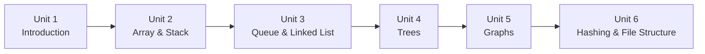
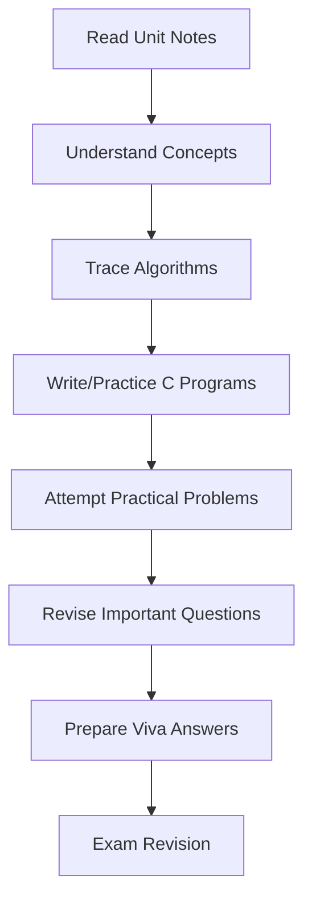

<div align="center">

# 📘 CEM2003C — Data Structures (Semester 3)

### B.Tech CSE • Student Learning Repository

A complete, student-focused Data Structures resource for Semester 3 covering
core concepts, C programs, lab practical preparation, viva revision, and exam support.


</div>

---

## 📑 Table of Contents

- [🎯 Course Information](#-course-information)
- [🌟 Learning Outcomes](#-learning-outcomes)
- [🧭 Unit Roadmap](#-unit-roadmap)
- [📚 Theory Resources (Unit-wise)](#-theory-resources-unit-wise)
- [🧪 Laboratory Practicals](#-laboratory-practicals)
- [📝 Exam & Viva Preparation](#-exam--viva-preparation)
- [🔁 Concept-to-Practice Workflow](#-concept-to-practice-workflow)
- [🛤️ Recommended Study Path](#️-recommended-study-path)
- [🗂️ Repository Structure](#️-repository-structure)
- [⚙️ Setup & Usage](#️-setup--usage)
- [🤝 Contribution Guidelines](#-contribution-guidelines)
- [📄 License](#-license)

---

## 🎯 Course Information

| Field | Details |
|---|---|
| Course Name | Data Structures |
| Course Code | CEM2003C |
| Semester | 3 |
| Programme | B.Tech CSE |
| Repository Purpose | Semester-long learning, coding practice, practical support, viva and exam revision |

---

## 🌟 Learning Outcomes

By using this repository, students can:

- Build fundamentals of linear and non-linear data structures
- Understand algorithm efficiency using asymptotic analysis
- Practice implementation-oriented learning through C programs
- Prepare for lab practicals, viva questions, and end-semester revision

---

## 🧭 Unit Roadmap



---

## 📚 Theory Resources (Unit-wise)

| Unit | Topics | Resource Link | Current Status |
|---|---|---|---|
| Unit 1 | Introduction, classification, operations, algorithm analysis, asymptotic notations | [Unit-1-Introduction](./Unit-1-Introduction/) • [README](./Unit-1-Introduction/README.md) | ✅ Complete |
| Unit 2 | Arrays, sparse matrix, stack operations, expression conversion/evaluation, recursion, Tower of Hanoi | [Unit-2-Array-and-Stack](./Unit-2-Array-and-Stack/) • [README](./Unit-2-Array-and-Stack/README.md) | ✅ Complete |
| Unit 3 | Queue, circular queue, deque, priority queue, linked lists | [Unit-3-Queue-and-Linked-List](./Unit-3-Queue-and-Linked-List/) • [README](./Unit-3-Queue-and-Linked-List/README.md) | ✅ Complete |
| Unit 4 | Trees, traversals, BST, AVL, B-Tree, B+ Tree | [Unit-4-Trees](./Unit-4-Trees/) • [README](./Unit-4-Trees/README.md) | ✅ Complete |
| Unit 5 | Graphs | [Unit-5-Graphs](./Unit-5-Graphs/) | ⏳ In Progress |
| Unit 6 | Hashing methods, collision handling, blockchain basics, file structures, indexing | [Unit-6-Hashing-and-File-Structure](./Unit-6-Hashing-and-File-Structure/) • [README](./Unit-6-Hashing-and-File-Structure/README.md) | ✅ Complete |

> Note: Unit 5 currently contains placeholder content only.

---

## 🧪 Laboratory Practicals

This repository is structured to support all prescribed practicals.

### Practical Progress

| Practical Set | Status |
|---|---|
| Practical 1–5 | ⏳ Pending |
| Practical 6–10 | ⏳ Pending |
| Practical 11–15 | ⏳ Pending |

Lab directory: [Lab-Manual](./Lab-Manual/)

---

## 📝 Exam & Viva Preparation

| Section | Link | Status |
|---|---|---|
| Exam Preparation | [Exam-Preparation](./Exam-Preparation/) | ⏳ Coming Soon |
| Viva Preparation | [Viva-Preparation](./Viva-Preparation/) | ⏳ Coming Soon |

---

## 🔁 Concept-to-Practice Workflow



---

## 🛤️ Recommended Study Path

1. Start from Unit 1 and move unit-by-unit in sequence.
2. Complete topic notes and checklists inside each unit README.
3. Practice implementation in C while studying each topic.
4. Use important/viva question sets for quick revision.
5. Before exams, focus on weak units and practical problem patterns.

---

## 🗂️ Repository Structure

```text
Data-Structures-Sem3/
├── Unit-1-Introduction/
├── Unit-2-Array-and-Stack/
├── Unit-3-Queue-and-Linked-List/
├── Unit-4-Trees/
├── Unit-5-Graphs/
├── Unit-6-Hashing-and-File-Structure/
├── Lab-Manual/
├── Exam-Preparation/
├── Viva-Preparation/
├── SYLLABUS.md
├── ROADMAP.md
├── CONTRIBUTING.md
└── README.md
```

---

## ⚙️ Setup & Usage

No build setup is required for reading notes.

To use this repository effectively:

1. Browse unit folders in order.
2. Open each unit README and follow topic links.
3. Practice the covered algorithms/programs in C on your local compiler.
4. Use exam/viva sections as revision checkpoints.

---

## 🤝 Contribution Guidelines

Contributions, corrections, and improvements are welcome.

Please read [CONTRIBUTING.md](./CONTRIBUTING.md) before opening a pull request.

---

## 📄 License

This project is licensed under the [MIT License](./LICENSE).
